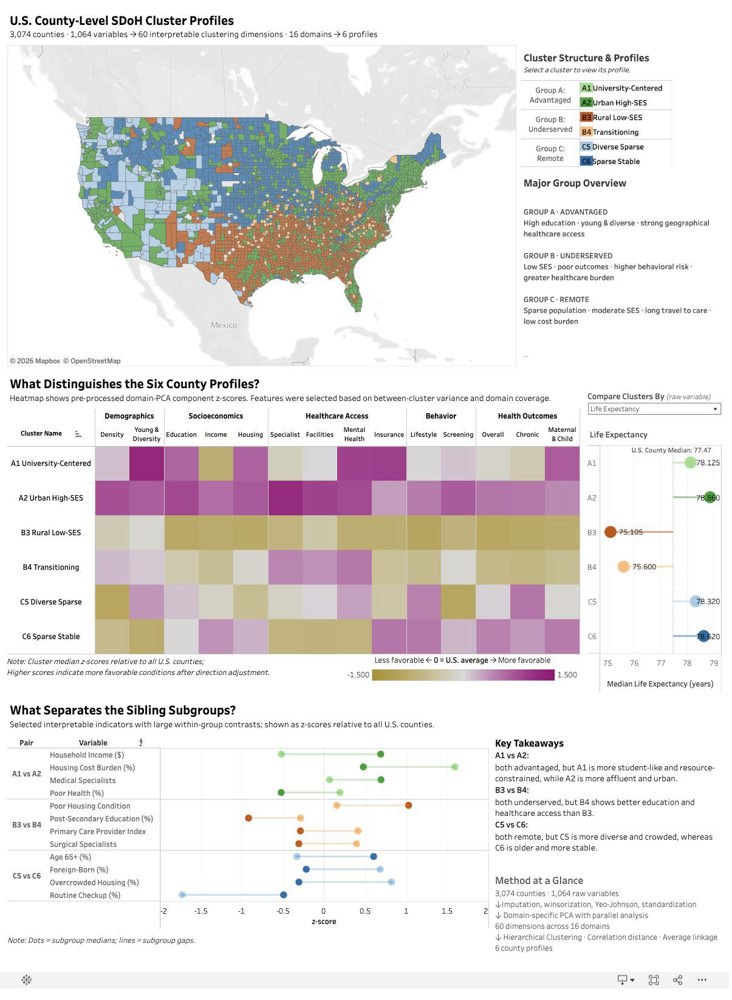

# U.S. County-Level SDOH Cluster Profiles

A case study of multidimensional social determinants of health (SDOH) patterns across 3,074 U.S. counties.

**[Explore the interactive Tableau dashboard](https://public.tableau.com/app/profile/yuanyan.zou/viz/SDOH_County_Cluster/Dashboard)**

|                  |                                                                                                                       |
| ---------------- | --------------------------------------------------------------------------------------------------------------------- |
| **Domain**       | Population health analytics, SDOH county typology                                                                     |
| **Sample**       | 3,074 counties across the 48 contiguous states (2018)                                                                 |
| **Methods**      | Domain-guided PCA and composite indices, hierarchical clustering, cluster validation                                  |
| **Stack**        | Python · pandas · NumPy · SciPy · scikit-learn · statsmodels · R · Tableau                                            |
| **Data sources** | AHRQ SDOH Database · County Health Rankings & Roadmaps                                                                |
| **My role**      | Collaborative preprocessing and feature reduction; hierarchical clustering; profile interpretation; Tableau dashboard |

## Project Overview

This project explores whether U.S. counties form recurring multidimensional SDOH profiles, and how those profiles can be translated into policy-relevant county typologies. The analysis used data from the Agency for Healthcare Research and Quality (AHRQ) Social Determinants of Health Database and County Health Rankings. The 1,064 raw variables covered 16 SDOH domains spanning demographics, socioeconomic conditions, family and housing context, healthcare access and long-term care, health behaviors and outcomes, disease burden, environment, and geography. We reduced a high-dimensional SDOH feature space and identified three broad groups containing six distinct county profiles. My focus was the hierarchical clustering analysis, cluster validation and interpretation, and the interactive Tableau dashboard. 

## Key Findings

- **Broad county groups contain distinct and interpretable subgroups.**
  Each of the three broad groups (Advantaged, Underserved, Remote) contains two subgroups with distinct problem structures, suggesting counties sharing a broad structural pattern can still differ meaningfully in socioeconomic conditions, healthcare access, or demographics. For example, B3 Rural Low-SES counties face severely limited healthcare capacity and the poorest health outcomes, while B4 Transitioning counties have relatively low SES and health outcomes, but comparatively better healthcare access and housing condition. A single "underserved" label would obscure differences that matter for targeted resource allocation. 

- **A small cluster can carry coherent pattern and interpretive value.**
  The smallest subgroup (n=12) formed a coherent University-Centered profile with unusually high educational attainment and strong insurance coverage but low median household income and a distinct healthcare-resource pattern. Despite its small size, A1 is internally coherent across profile statistics, and review of individual member counties confirms the university-centered economic pattern, which is substantively distinct from the larger Urban High-SES group (A2), supporting retention of the subgroup rather than merging it solely because of its size.

[](https://public.tableau.com/app/profile/yuanyan.zou/viz/SDOH_County_Cluster/Dashboard)

## Analytical Workflow

```text
3,074 counties x 1,064 raw variables
                |
                v
Imputation, winsorization, Yeo-Johnson transformation, and standardization
                |
                v
Domain-guided feature construction and reduction
PCA with parallel analysis + composite indices
                |
                v
60 retained analytical features across 16 domains
                |
                v
Hierarchical clustering: correlation distance + average linkage
                |
                v
3 broad groups -> 6 county profiles
```

### Why hierarchical clustering?

Hierarchical clustering was used alongside the team's K-means analysis because it reveals nested structure rather than requiring every county to enter a single flat partition from the outset. This made it possible to retain three broad groups while examining meaningful sibling subgroups within each group.

Three decisions shaped the final solution:

- **Correlation distance** compares the shape of counties' multidomain profiles rather than relying only on absolute proximity in the component space. This helped surface counties with similar relative patterns even when their overall levels differed.
- **Average linkage** is compatible with correlation distance and is less dependent on spherical, similarly sized clusters than Ward-style alternatives. This was important because urban, rural, and remote county profiles were not expected to occur in balanced groups.
- **Six clusters** were retained using dendrogram structure, pairwise Kolmogorov-Smirnov similarity checks, and substantive interpretability. Splits through six clusters produced distinct sibling profiles; additional splits at seven or eight clusters were more similar and lacked a clear new interpretation.

The six-cluster solution had a pseudo-R-squared of 0.32. Across 20 high-contributing features, 78.3% of pairwise Tukey comparisons were statistically significant. These diagnostics support meaningful separation.

## How the County Profiles Were Interpreted

Cluster labels were developed through a structured interpretation process rather than from a single indicator:

1. Rank retained features by their contribution to between-cluster variation.
2. Examine cluster medians and dispersion on the strongest contributors.
3. Trace influential PCA-derived features back to their highest positive and negative raw-variable loadings, and review the definitions of retained composite indices.
4. Check medoid counties and geographic distributions for concrete, real-world context.
5. Synthesize recurring patterns across demographics, socioeconomic conditions, healthcare access, behavior, and health outcomes.
6. Assign concise, descriptive profile names and develop cautious, data-informed policy considerations.

This process produced six profiles nested within three broad groups:

| Broad group    | County profiles                           |
| -------------- | ----------------------------------------- |
| A. Advantaged  | A1 University-Centered; A2 Urban High-SES |
| B. Underserved | B3 Rural Low-SES; B4 Transitioning        |
| C. Remote      | C5 Diverse Sparse; C6 Sparse Stable       |

## What the Dashboard Shows

- A county map showing the geographic distribution of the six clusters.
- A direction-aligned heatmap of selected analytical-feature z-scores.
- An interactive raw-indicator comparison against the U.S. county median.
- Sibling-subgroup contrasts highlighting interpretable within-group differences.
- Clickable cluster summaries connecting statistical profiles with concise contextual descriptions.

## My Role and Team Collaboration

This project was completed by a three-person team for UC Davis STA 221. Preprocessing and domain-guided feature reduction were team decisions. I proposed the preprocessing sequence (mechanism-specific imputation, winsorization, Yeo-Johnson) and the domain-specific PCA approach; teammates implemented the PCA code.

I led the following work:

- Independently implementing the hierarchical clustering analysis in Python.
- Evaluating and selecting the distance metric, linkage method, and final number of clusters.
- Validating and interpreting the six profiles.
- Writing all related sections of the project report, and presenting the results.
- Designing and building the interactive Tableau dashboard presented above.

## Limitations

- The analysis is a cross-sectional snapshot based on 2018 data; cluster patterns may change over time.
- Domain-guided feature reduction improves interpretability and tractability but necessarily compresses some information.
- The University-Centered profile contains only 12 counties and should be interpreted cautiously.
- Alaska, Hawaii, the District of Columbia, and U.S. territories were excluded from the analytical scope.

## Repository Scope

This repository is intentionally scoped as a visual analytical case study rather than a full reproducibility package. It presents the interactive dashboard, methodological reasoning, and interpretation workflow; project data, shared code, and the full course report are not redistributed here.
